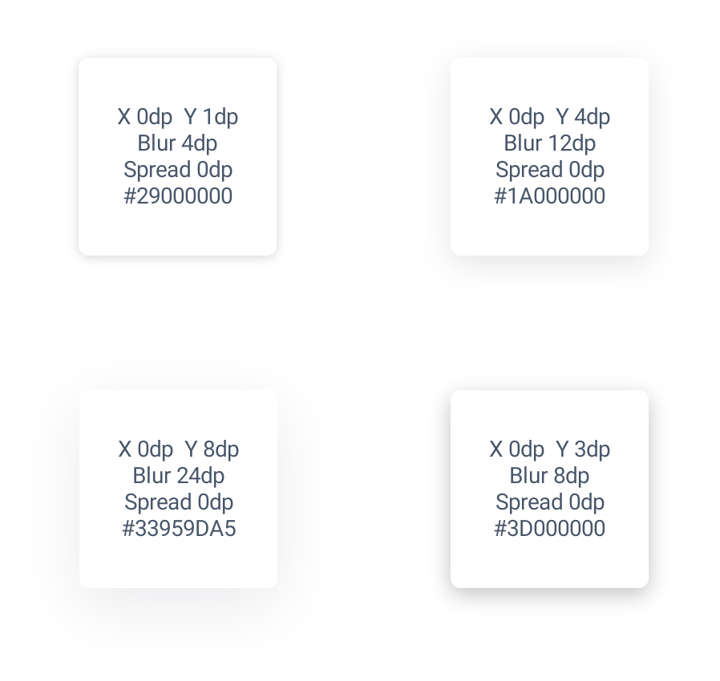

# BoxShadowLayout

在 Android XML 中给 View 添加 CSS 风格的内外阴影。背景、边框和阴影共用同一个圆角轮廓，四个角可以分别设置。



## 安装

1.0.0 通过 GitHub 分发。在 `settings.gradle.kts` 已有的 `dependencyResolutionManagement.repositories` 中加入：

```kotlin
maven {
    url = uri("https://raw.githubusercontent.com/Josense/BoxShadow/maven-1.0.0-r2/")
    content { includeModule("io.github.josense", "boxshadow") }
}
```

在应用模块的 `build.gradle.kts` 中添加：

```kotlin
dependencies {
    implementation("io.github.josense:boxshadow:1.0.0")
}
```

## 许可证

本项目采用 [Apache License 2.0](LICENSE)。
