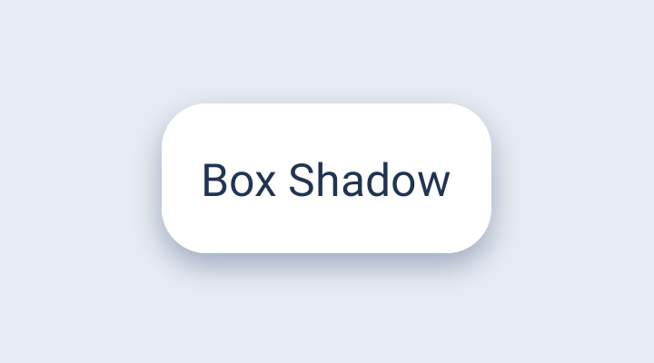
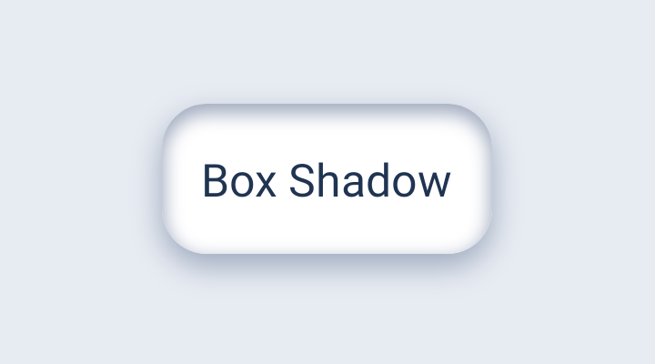

# BoxShadowLayout

适用于 Android XML View 的 Kotlin 阴影容器。在一个子控件周围绘制 CSS 风格的外阴影和内阴影，支持四角独立圆角、正负扩张和偏移，也可以设置背景色、Drawable 背景和边框。

**版本** `1.0.0` · **最低系统** Android 4.1（API 16）· **消费工程** `compileSdk` 36 或更高

| 仅外阴影 | 外阴影 + 内阴影 |
| :---: | :---: |
|  |  |

两张图均截自 Android demo。右图只开启了内阴影，卡片的尺寸、圆角和外阴影参数与左图相同。

## 安装

在 `settings.gradle.kts` 中添加 GitHub 托管的 1.0.0 Maven 仓库：

```kotlin
dependencyResolutionManagement {
    repositories {
        google()
        mavenCentral()
        exclusiveContent {
            forRepository {
                maven { url = uri("https://raw.githubusercontent.com/Josense/BoxShadow/maven-1.0.0/") }
            }
            filter { includeModule("io.github.josense", "boxshadow") }
        }
    }
}
```

在应用模块的 `build.gradle.kts` 中添加：

```kotlin
dependencies {
    implementation("io.github.josense:boxshadow:1.0.0")
}
```

离线接入时，将 [Maven 分发包](dist/boxshadow-1.0.0-maven.zip) 解压到工程的 `vendor/boxshadow/`，将上方仓库 URL 替换为 `uri(rootDir.resolve("vendor/boxshadow"))`。

## XML 用法

```xml
<com.josense.boxshadow.BoxShadowLayout
    xmlns:android="http://schemas.android.com/apk/res/android"
    xmlns:app="http://schemas.android.com/apk/res-auto"
    android:layout_width="wrap_content"
    android:layout_height="wrap_content"
    app:boxFillColor="#F4F7FF"
    app:boxStrokeWidth="2dp"
    app:boxStrokeColor="#6886BB"
    app:boxCornerRadius="16dp"
    app:boxBottomRightRadius="4dp"
    app:shadowColor="#55304870"
    app:shadowBlurRadius="10dp"
    app:shadowOffsetY="4dp"
    app:innerShadowColor="#66506388"
    app:innerShadowBlurRadius="6dp"
    app:innerShadowOffsetY="2dp">

    <TextView
        android:layout_width="160dp"
        android:layout_height="64dp"
        android:gravity="center"
        android:text="Box Shadow" />
</com.josense.boxshadow.BoxShadowLayout>
```

容器接受一个直接子 View，也可以是 ViewGroup。外层为外阴影预留空间。使用 `wrap_content` 时，容器尺寸包含子 View、margin、容器 padding、两侧边框和外阴影留白。固定容器尺寸时，`match_parent` 子 View 使用扣除这些空间后的区域。绘制顺序为外阴影、卡片底色和背景、内阴影、边框、子 View。使用内阴影时，将卡片底色设在 `boxFillColor` 上，让子 View 的背景透明。

| 参数 | 用途 |
| --- | --- |
| `boxFillColor` | 卡片底色，默认透明 |
| `boxBackground` | 图片、渐变等 Drawable，绘制在底色上并按卡片轮廓裁剪。Drawable 的 bounds 为整张卡片 |
| `boxStrokeWidth`、`boxStrokeColor` | 向内绘制的纯色边框，位于内阴影之上、子内容之下。默认宽度为零；非零宽度参与测量，内阴影沿边框内缘绘制 |
| `boxCornerRadius` | 四角的默认半径。可用 `boxTopLeftRadius`、`boxTopRightRadius`、`boxBottomLeftRadius`、`boxBottomRightRadius` 分别覆盖 |
| `shadowColor`、`innerShadowColor` | 各自的 ARGB 颜色。指定 `innerShadowColor` 即启用内阴影 |
| `shadowBlurRadius`、`innerShadowBlurRadius` | 非负模糊半径 |
| `shadowSpread`、`innerShadowSpread` | 可正可负。正值使外阴影向外扩，内阴影向中心延伸 |
| `shadowOffsetX/Y`、`innerShadowOffsetX/Y` | 分别用 X、Y 属性设置水平和垂直偏移 |

Kotlin 端通过 `layout.shadow`、`layout.innerShadow`、`layout.boxFillColor` 更新样式，长度单位为 px。将 `innerShadow` 设为 `null` 即可关闭内阴影。

## 构建与演示

运行 `:demo` 可交互调整全部阴影参数。执行 `./gradlew :boxshadow:packageDistribution` 可重新生成 `dist/` 下的版本化分发包，内含 Release AAR、源码和文档 JAR、POM、Gradle 依赖元数据及许可证。

维护者的签名与上传步骤见[发布说明](docs/publishing.md)。

## 许可证

本项目采用 [Apache License 2.0](LICENSE)。
